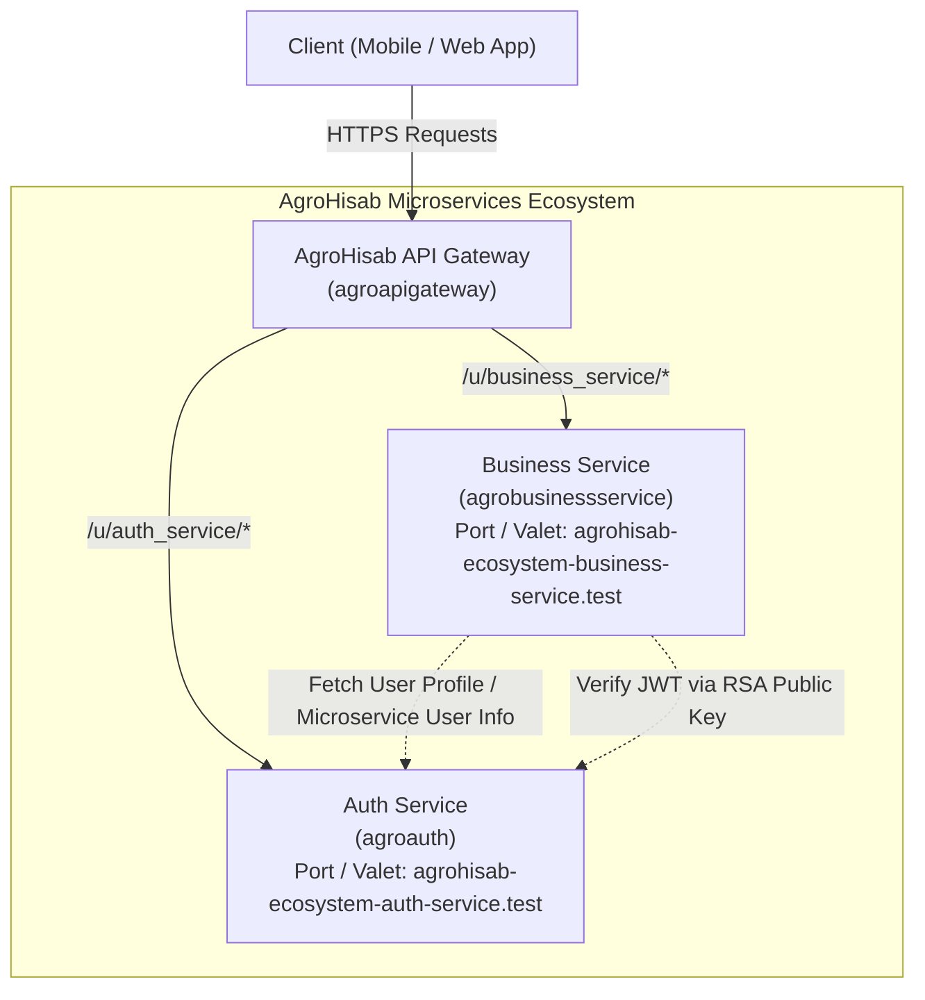

# AgroHisab Ecosystem Architecture

## 1. Microservice Ecosystem Overview

The AgroHisab system is built as a distributed microservice ecosystem designed to serve agricultural trading and consignment businesses in Bangladesh.



### 1.1 Service Directory

| Service Name | Repository / Folder | Database | Role & Scope |
| :--- | :--- | :--- | :--- |
| **API Gateway** | `AgroHisab-ecosystem-api-gateway` | `agroapigateway` | Reverse proxy, centralized routing (`/p/`, `/u/`, `/m/`), circuit breaker, edge token validation, header sanitation (`X-Request-ID`). |
| **Auth Service** | `AgroHisab-ecosystem-auth-service` | `agroauth` | Identity provider, user authentication, OAuth2 / JWT token issuance (RSA key pair), RBAC, Company/Tenant master, common file upload. |
| **Business Service** | `AgroHisab-ecosystem-business-service` | `agrobusinessservice` | Agricultural trading & consignment business logic: Purchases, Shipments/Challans, Goods Receipts, Commission Sales, Stock Movements, Party Ledgers, Settlements & P&L. |

---

## 2. Authentication, Authorization & Security Flow

### 2.1 Token Issuance & Verification
1. **User Authentication:** Client authenticates against `Auth Service` (`POST /api/v1/auth/login`).
2. **JWT Token:** Auth Service issues a JWT signed using its private key (`storage/oauth-private.key`). Claims include `sub` (User ID), `company_id`, `email`, `role`, and expiration timestamps.
3. **Gateway Verification & Forwarding:** Client makes requests to `API Gateway` at `/u/business_service/v1/...`. Gateway verifies token validity and forwards the request downstream with incoming `Authorization: Bearer <token>` and `X-Request-ID`.
4. **Business Service Verification:** Downstream `Business Service` uses `AuthenticateWithJwt` middleware to verify the asymmetric signature using Auth Service's public key (`oauth-public.key` or URL endpoint `GET /api/v1/auth/public-key`).
5. **Context Injection:** `AuthenticateWithJwt` sets `$request->attributes->set('jwt_claims', $claims)`.
   - `authId()` helper retrieves the authenticated user ID.
   - `user()` helper fetches/caches user metadata from Auth Service via `UserCacheService` and machine token authentication.

### 2.2 Multi-Tenancy / Company Isolation
- Models in `Business Service` utilize the `HasCompany` trait and `CompanyScope`.
- Automatically binds `company_id` from JWT claims on query execution and model creation.

---

## 3. Business Service Layered Architecture & Conventions

To maintain uniformity and high standards across the ecosystem, `AgroHisab-ecosystem-business-service` enforces the following code conventions:

### 3.1 Controller Layer
Controllers extend `App\Http\Controllers\Controller` and wrap request execution using `$this->handleRequest(...)`:
```php
class PurchaseController extends Controller
{
    public function __construct(protected PurchaseService $purchaseService) {}

    public function index(Request $request)
    {
        return $this->handleRequest(function () use ($request) {
            $data = $this->purchaseService->paginate($request->all());
            return ApiResponse::success($data, 'Purchases retrieved successfully');
        });
    }
}
```

### 3.2 Standardized API Responses (`ApiResponse`)
- Success: `ApiResponse::success($data, $message, $status = 200)`
- Failure: Caught by `handleRequest()` returning `ApiResponse::error($throwable)` with appropriate HTTP status code (422 for validation, 403 for unauthorized, 404 for not found, 500 for server exceptions).

### 3.3 Service & Repository Pattern
- Controllers do not execute direct SQL or financial calculations.
- All transactional workflows (Purchases, Shipments, Goods Receipt, Sales, Settlements) reside in dedicated Service classes (`app/Services/Business/...`).
- Multi-table financial and inventory mutations must always run inside `DB::transaction(...)`.

### 3.4 Data Integrity, Numbers & Rounding
- **Currency:** BDT (৳). All monetary columns stored as `DECIMAL(15,2)`.
- **Quantities:** Stored as `DECIMAL(12,4)` to handle fractional maunds, kilograms, and sacks.
- **Stock Movements:** Stock is NEVER updated via direct column modification (`stock = stock - 5`). It is driven strictly through immutable `stock_movements` ledger entries.
- **Financial Records:** Financial transactions are immutable. Cancellations and adjustments are executed as reversals/adjustment entries (`reversal_of_id`), never hard deletes.

---

## 4. Legacy Code Deprecation and Cleanup Strategy

The current `AgroHisab-ecosystem-business-service` contains legacy/scaffolded code originating from a retail field-visit template (`outlets`, `beats`, `visits`, `kpis`, etc.).
This legacy code will be cleaned up systematically:
1. **Phase 0:** Audit, documentation, business rule confirmation.
2. **Phase 1-2:** Clean removal of old outlet/visit routes, models, and controllers in favor of Agricultural Trading entities (`products`, `units`, `suppliers`, `aratdars`, `markets`, `transporters`, `accounts`).
3. **Phase 3-8:** Step-by-step introduction of transaction modules (Purchases, Shipments, Goods Receipts, Commission Sales, Payments, Settlement Reconciliation, Documents, Reports).
