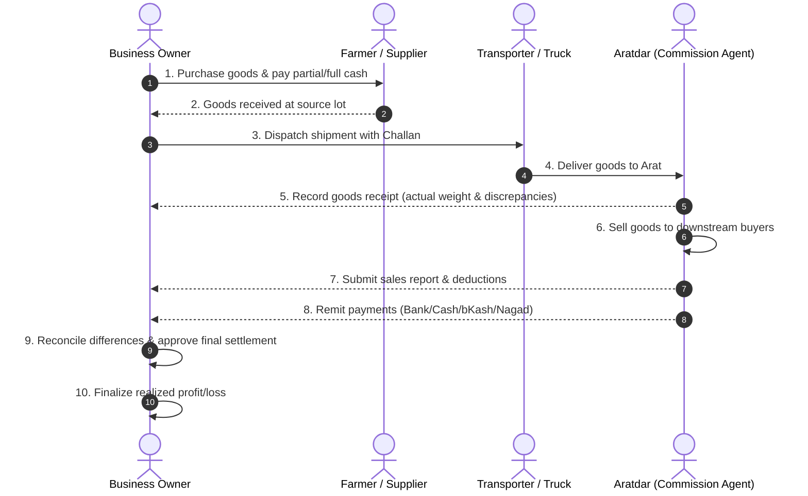

# Agricultural Trading & Consignment Business Rules

## 1. Core Workflow Overview

The business operates on an agricultural produce trading and commission consignment model in Bangladesh (e.g., purchasing in Shailkupa or Kumarkhali markets and dispatching to aratdars across different districts).

---

## 2. Fundamental Invariants & Operating Rules

### 2.1 Distinct Events & Non-Collapsing Lifecycle
1. **Never conflate distinct stages:** Purchase, dispatch, receipt, sales report, expense, payment remittance, and settlement are distinct events.
2. A shipment must never be automatically flagged "Settled" solely because an aratdar claimed all stock was sold.
3. Settlement requires owner review, discrepancy acceptance, and explicit sign-off.

### 2.2 Stock Invariants & Ledger
All inventory balances must be backed by immutable `stock_movements`:
- **Dispatch Invariant:**
  $$\text{Dispatched Quantity} = \text{Received Quantity} + \text{In-Transit Shortage/Damage}$$
- **Post-Receipt Invariant:**
  $$\text{Received Quantity} = \text{Sold Quantity} - \text{Sales Returns} + \text{Remaining Unsold Stock} + \text{Damaged/Disposed Quantity} + \text{Approved Adjustments}$$
- Negative stock is strictly prohibited.
- Stock allocations link shipment items back to source purchase lots.

### 2.3 Financial Invariants & Profit Logic
1. **Purchase Line Total:**
   $$\text{Line Total} = (\text{Quantity} \times \text{Unit Rate}) - \text{Line Discount}$$
2. **Gross & Net Sales:**
   $$\text{Gross Sales} = \text{Sold Quantity} \times \text{Unit Rate}$$
   $$\text{Net Sales} = \text{Gross Sales} - \text{Sale Discount} - \text{Approved Returns}$$
3. **Commission Calculation:**
   - Percentage: $\text{Commission} = \text{Agreed Base} \times \frac{\text{Agreed Rate}}{100}$
   - Fixed: Contract-defined flat rate per bag, per maund, or per shipment.
   - Commission rule version must be locked at the time of sale recording to prevent retroactively changing historical commissions.
4. **Expected Net Proceeds from Aratdar:**
   $$\text{Expected Net Proceeds} = \text{Net Sales} - \text{Commission} - \text{Approved Deductions}$$
5. **Realized Profit / Loss:**
   $$\text{Realized Profit} = \text{Net Sales of Sold Qty} - \text{Allocated COGS of Sold Qty} - \text{Owner-Borne Consignment Expenses} - \text{Commission} - \text{Other Approved Deductions}$$
   *Crucial rule:* Unsold stock remains an asset at its allocated cost—it is NOT a realized loss.

---

## 3. Unresolved Business Decisions (Must Confirm with Owner)

Per Section 13 of `BUSINESS_MANAGEMENT_APP_SPEC.md`, the AI agent must not make arbitrary assumptions for these 10 critical items:

| # | Topic | Questions / Decisions for Owner Confirmation | Default / Proposal if Unspecified |
| :- | :--- | :--- | :--- |
| **1** | **Unit Conversion** | What is the exact Kg-to-Mon conversion across target markets? (e.g., standard 40.00 kg/mon vs market variations like 40.50 kg or 41.20 kg with dhola/kacha weight)? | Configurable per product/market; default 1 Mon = 40 Kg with override. |
| **2** | **Commission Basis** | Is commission percentage calculated on Gross Sales, Net Sales (after discount), or fixed amount per bag/maund? | Configurable per Aratdar agreement; default % on Gross Sales. |
| **3** | **Cost Allocation** | When 1 purchase lot is split across multiple shipments, how are purchase price and transport allocated? | Weighted average cost per product lot. |
| **4** | **Transport Expense** | Who bears freight, loading, unloading, and toll costs (Owner, Aratdar, or Buyer)? | Recorded by party (`owner`, `aratdar`, `shared`) with explicit assignment. |
| **5** | **Loss Responsibility** | Who absorbs transit shortage, arat weight loss, or spoiled produce? | Explicit loss classification: `owner_loss`, `transporter_claim`, `aratdar_deduction`. |
| **6** | **Sales Verification** | What evidence is mandatory before verifying an aratdar sales report? | Photo/PDF attachment of Arat sale memo / voucher. |
| **7** | **Payment Allocation** | If an aratdar sends a lump sum without specifying the shipment, how is it allocated? | FIFO (oldest open receivable first) or manual allocation workflow. |
| **8** | **Returns & Refunds** | Are returns treated as separate return vouchers or inline sales adjustments? | Distinct sales return records with linked stock restoration. |
| **9** | **Settlement Deadline** | What is the grace period for an aratdar to report sales and remit balances? | Configurable per agreement (e.g., 7 days after goods receipt). |
| **10**| **Backup & Storage** | Where should documents, challan PDFs, and DB backups be stored? | Local storage initially with scheduled S3/cloud backup capability. |
